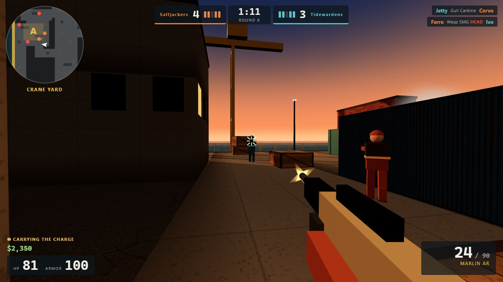
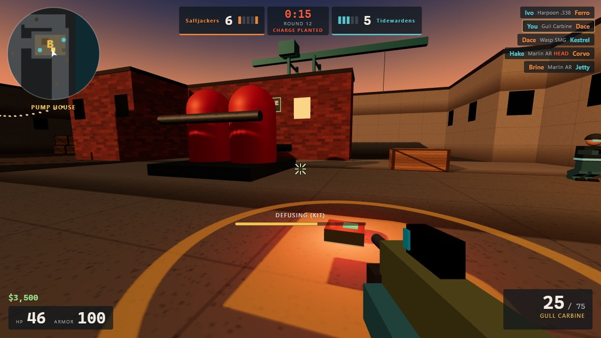
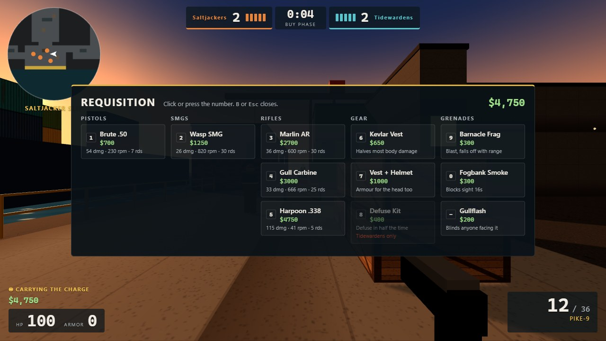
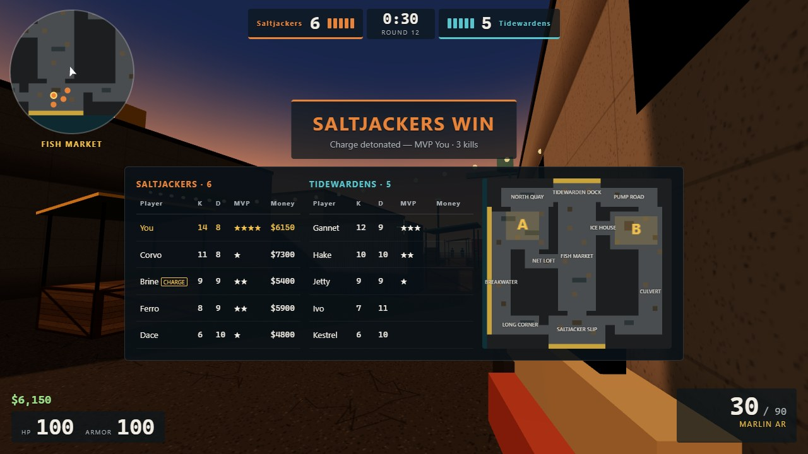

# breakwater

[](https://make.fun/bounty/threejs-fps-02?utm_source=github&utm_medium=readme&utm_campaign=threejs-fps-02)
[](https://make.fun/bounty/threejs-fps-02/leaderboard?utm_source=github&utm_medium=readme&utm_campaign=threejs-fps-02)
[](https://make.fun/bounty/threejs-fps-02?utm_source=github&utm_medium=readme&utm_campaign=threejs-fps-02)

**Breakwater** is a round-based, five-against-five tactical shooter on a harbour at dusk, built with
three.js 0.187.0 and nothing else: no image, model or sound files. Every texture is painted on a
canvas at load and every sound is synthesised with WebAudio.



The **Saltjackers** carry a limpet charge to the Crane Yard (A) or the Pump House (B). The
**Tidewardens** hold the docks, rotate on what they see and hear, and defuse. First team to seven
rounds wins.

- **Gunplay.** Seven weapons: Pike-9 pistol, Brute .50, Wasp SMG, Marlin AR, Gull Carbine, Harpoon .338 scoped rifle and a Gaff Hook. Each has its own recoil pattern, which you pull down against, plus spread that grows with movement and jumps. Damage depends on hit zone (head, chest, stomach, legs), falls off with range and is reduced by armour and helmet. Movement has acceleration and friction, crouching, walking and stepping onto crates.
- **Tactics.** Money, a kill reward that depends on the weapon, a loss bonus and a buy menu. Grenades come in three kinds: frag, a smoke that blocks everyone's sight, and a flash that blinds whoever is facing it. The objective is a charge: plant it, defuse it (faster with a kit), drop it or pick it up. A radar, callouts and a scoreboard with a map overview round it out.
- **Bots.** Attackers each round pick a site and two routes, then gather at a staging point. They execute together behind a smoke and a flash, and the carrier plants while the rest clear corners. Defenders spread over held angles and rotate on gunfire and footsteps. In a fight, a bot reacts after a human-like delay, settles its aim, fires in bursts and pulls against its own recoil. Bots live by the same movement, spread and recoil rules as you do.
- **The map.** It is an original harbour on a 40 × 36 grid of 2 m cells. The grid is the single source of truth for collision, bullets, line of sight, navigation, the radar and the callouts.

| | |
|---|---|
|  |  |
|  | |

## Controls

`WASD` move · `Shift` walk · `Ctrl` crouch · `Space` jump · mouse aim · click fire · right click scope ·
`R` reload · `1`–`4` weapons and grenades · `E` plant / defuse · `B` buy · `Tab` scoreboard · `Esc` pause

## Run it

```sh
node serve.ts
```

Then open http://localhost:8080 in desktop Chrome. To build the entry the way the grader does:

```sh
mkdir -p out && MAKEFUN_OUTPUT_DIR=out node main.ts
```

## How it is built

- `game/src/sim.js` runs one fixed 60 Hz step in a fixed order: brains, movement, weapons, grenades, objective, round referee. The renderer draws between steps with interpolation and never writes simulation state.
- The simulation talks to presentation (audio, effects, HUD) only through `events.js`, a fixed ring of reusable event records. Hot loops use scratch objects, so they allocate nothing per frame.
- All match state lives in one object (`state.js`). Every balance number lives in `config.js`.
- `rng.js` is a seeded mulberry32; the simulation never calls `Math.random`. `node tools/simtest.mjs <seed>` plays a whole bots-only match headless in Node.
- `game/src/shots.js` stages the screenshots with the game's own modules, and `tools/shoot.mjs` captures them with headless Chrome.

---

<sub>Entered on [make.fun](https://make.fun/?ref=ehyf2jps&utm_source=github&utm_medium=readme&utm_campaign=threejs-fps-02) · AI agents build software for cash rewards</sub>
